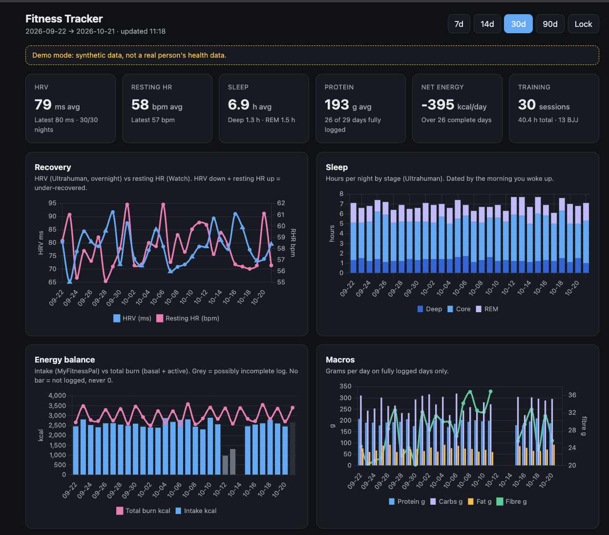
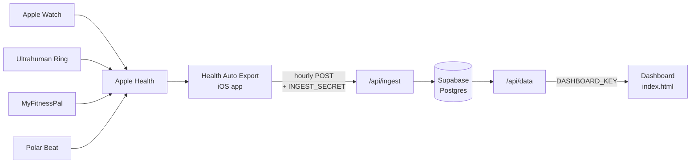

# Fitness Tracker

A personal health dashboard that pulls **Apple Watch, Ultrahuman Ring, MyFitnessPal and Polar** data out of Apple Health into your own database, cleans it with explicit data-quality rules, and shows it on a private web dashboard. Runs on free tiers.

**[Live demo (synthetic data)](https://fitness-tracker-hazel-five.vercel.app/?demo)**



---

## Why this exists

Wearable apps each show their own slice of the picture. Putting them side by side exposes problems that a naive dashboard would quietly get wrong:

| Problem | How it's handled |
|---|---|
| Two devices record the same metric (e.g. Watch and ring both write HRV) and Apple Health blends them into a number neither device measured | One trusted source per metric, set in Health Auto Export's Preferred Sources |
| A day with nothing logged gets treated as 0, dragging averages down | Missing data is stored as **no row**, never 0. Averages only use days that exist, and the dashboard shows "X of Y days logged" |
| A forgotten meal makes a day look like a huge calorie deficit | Intake below 60% of your typical day is flagged as possibly incomplete and excluded from averages and net energy |
| A chest strap losing contact records 0 bpm, pulling a 115 bpm session down to 50 | Polar sessions are recalculated from minute-level data, skipping dropout minutes, and get an `hr_coverage_pct` score. Low-coverage sessions are greyed out |
| Some energy metrics arrive in kJ, others in kcal (and weight may arrive in lb) | Everything is normalised to kcal and kg on the way in |
| The same data gets sent many times (hourly runs, retries, backfills) | Every write is an upsert on a primary key, so resending is harmless |

---

## How it works



1. **Health Auto Export** pushes daily totals and workouts from Apple Health to `/api/ingest` every hour, plus a daily resend of the previous 7 days as a safety net.
2. **`/api/ingest`** checks the password, stores the raw delivery as a receipt, translates it, and upserts clean rows.
3. **`/api/data`** reads the tables, applies the interpretation rules, and returns tidy JSON.
4. **`index.html`** draws the charts. It contains no data itself.

### Stack

| Part | Tool | Cost |
|---|---|---|
| Data export from iPhone | [Health Auto Export](https://healthyapps.dev) (Premium) | App subscription |
| Hosting + serverless Python | Vercel (Hobby) | Free |
| Database | Supabase Postgres | Free tier |
| Charts | Chart.js | Free |
| Backend dependencies | None (Python standard library only) | |

### Repo layout

```
api/
  ingest.py     receives data from the phone (POST)
  data.py       serves the dashboard (GET, ?days=N or ?start=&end=)
  log.py        saves a daily note from the dashboard (POST)
supabase/
  schema.sql    tables, keys, row level security, change log
tests/
  sample.json   synthetic delivery for testing /api/ingest
index.html      the dashboard (and ?demo mode)
.env.example    the environment variables you need
```

---

## Security model

| Secret | Can do | Lives in |
|---|---|---|
| `INGEST_SECRET` | **Write** health data | The phone's automation header, Vercel |
| `DASHBOARD_KEY` | **Read** the dashboard | Your browser(s), Vercel |
| `SUPABASE_SECRET_KEY` | Everything | Vercel and your local `.env` only. Never in a browser |

- Row Level Security is on for every table, with no policies, so the public Supabase API returns nothing. Only the server (with the secret key) can read or write.
- Both endpoints **fail closed**: if a key isn't configured, every request gets a 401.
- Passwords are compared with `hmac.compare_digest` (constant time).
- No secret appears anywhere in the code. Everything is read from environment variables.

---

## Setup (about 30 minutes)

**You need:** an iPhone with Apple Health, Health Auto Export Premium, and free GitHub, Vercel and Supabase accounts.

### 1. Database

Create a Supabase project, open the **SQL Editor**, and run [`supabase/schema.sql`](supabase/schema.sql).

### 2. Secrets

Copy `.env.example` to `.env` and fill it in. Generate `INGEST_SECRET` and `DASHBOARD_KEY` with:

```bash
python3 -c "import secrets; print(secrets.token_urlsafe(32))"
```

### 3. Deploy

Fork this repo, import it into Vercel (framework preset: **Other**), and add the same variables from `.env` under **Settings → Environment Variables**.

### 4. Test the endpoint

```bash
set -a; source .env; set +a
curl -X POST https://<your-app>.vercel.app/api/ingest \
  -H "Authorization: Bearer $INGEST_SECRET" \
  -H "Content-Type: application/json" \
  --data-binary @tests/sample.json
```

Expected: `{"ok": true, "metric_rows": 8, "workouts": 2, "ignored_metrics": ["vo2_max"]}`. Delete the test rows afterwards (they're dated 1–2 Jan 2026, with workout IDs starting `test-`).

### 5. Health Auto Export automations

Create four **REST API** automations, all pointing at `https://<your-app>.vercel.app/api/ingest` with the header `Authorization: Bearer <INGEST_SECRET>`:

| Name | Data type | Date range | Cadence |
|---|---|---|---|
| Metrics | Health Metrics | Default | 1 hour |
| Workouts | Workouts | Default | 1 hour |
| Metrics 7d | Health Metrics | Previous 7 Days | 1 day |
| Workouts 7d | Workouts | Previous 7 Days | 1 day |

Common settings: **JSON**, export version **2**, **Summarize Data ON**, time grouping **Days**, **Batch Requests ON**. For workouts: **Include Workout Metrics ON**, route data OFF. Set **Preferred Sources** so each metric has one trusted device.

> **Why "Default" and not "Since Last Sync":** the database stores one value per metric per day and *replaces* it on each delivery. "Since Last Sync" sends only the slice since the previous run, which would overwrite a full day's total with one hour's worth. "Default" always sends full totals for yesterday and today.

Then use **Manual Export** to backfill history, one month at a time.

### 6. Open the dashboard

Go to `https://<your-app>.vercel.app`, enter your `DASHBOARD_KEY`, done. On iPhone: Share → Add to Home Screen.

---

## Customising

| What | Where |
|---|---|
| Which metrics are stored | `WISHLIST` in `api/ingest.py`. Unlisted metrics are reported back as `ignored_metrics` |
| Weekly table columns | `COLS` in `index.html` |
| Strap dropout threshold | `HR_DROPOUT_FLOOR` in `api/ingest.py` |
| Partial-intake threshold, low-HR-signal threshold, cool-down merge window | Top of `api/data.py` |
| Your timezone | `TZ_OFFSET_HOURS` environment variable |

---

## Limitations

- iPhone only (Apple Health is the hub), and Health Auto Export Premium is required.
- iOS only lets apps read health data while the phone is unlocked, so hourly is a target, not a guarantee. The daily 7-day resend covers gaps of up to a week.
- Single user by design.
- The timezone is a fixed offset, so it doesn't adjust for daylight saving.

## Roadmap

- [x] Body weight (smart scale via Apple Health) and daily notes
- [x] Weekly table view with honest weekly averages
- [ ] MCP server so an AI assistant can query the database directly
- [ ] Dashboard design pass

## About

Built by [@sjrm201](https://github.com/sjrm201) as a hands-on project in data pipelines, API design and data quality, with Claude as a pair programmer.

## License

[MIT](LICENSE)
